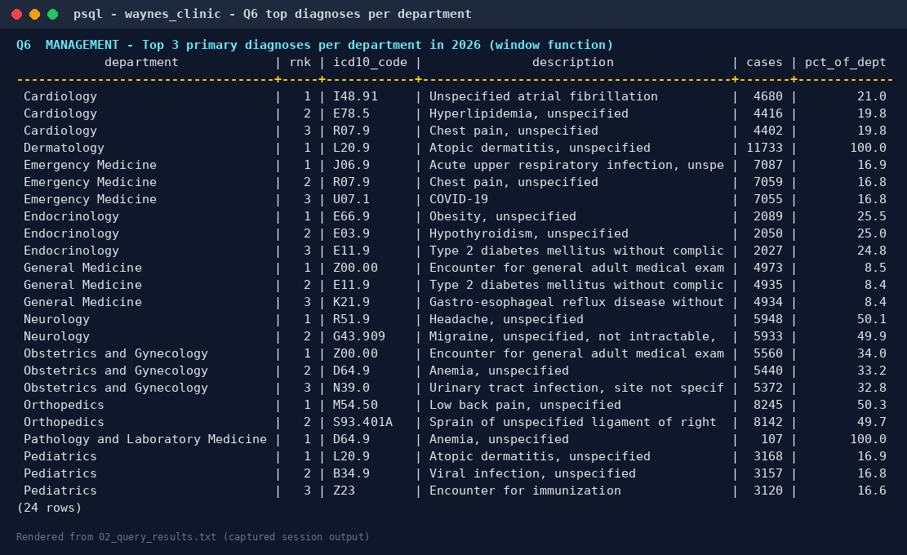
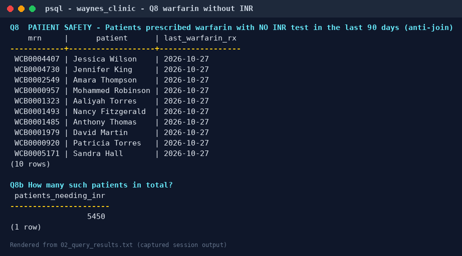
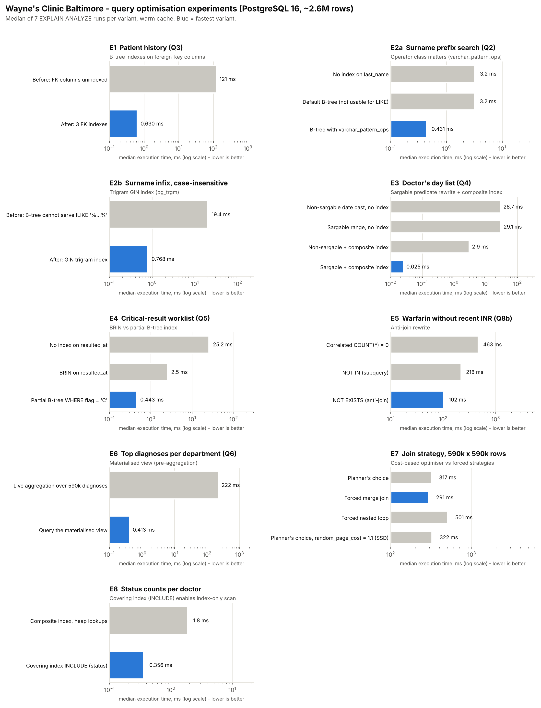
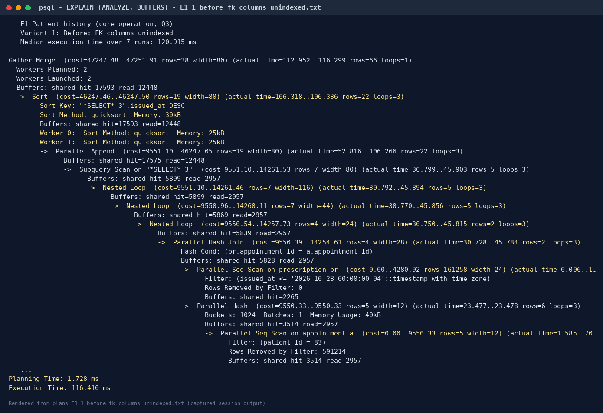
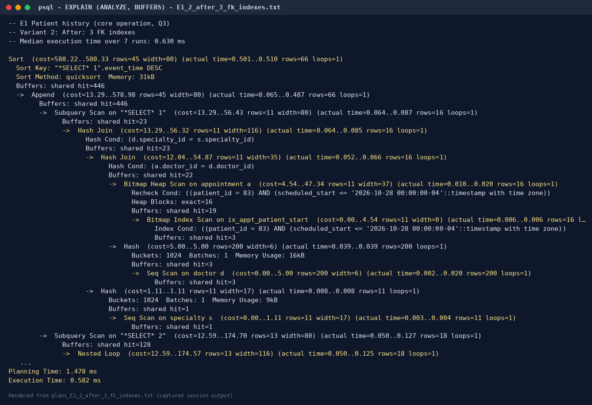
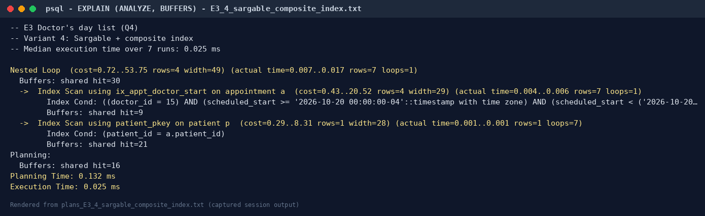
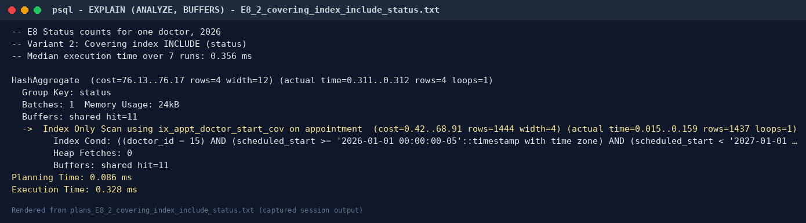
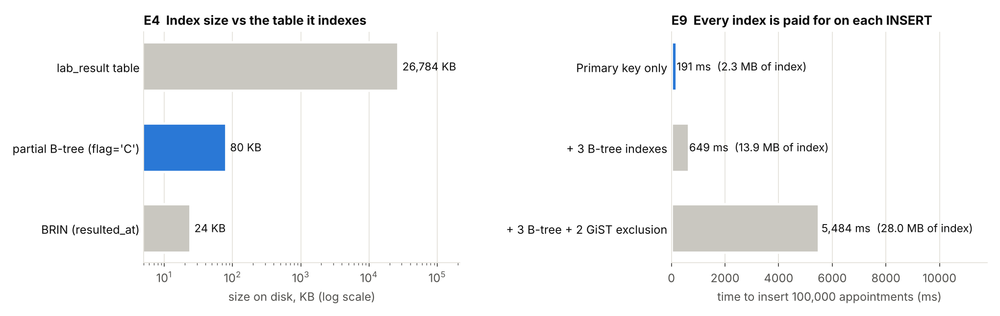
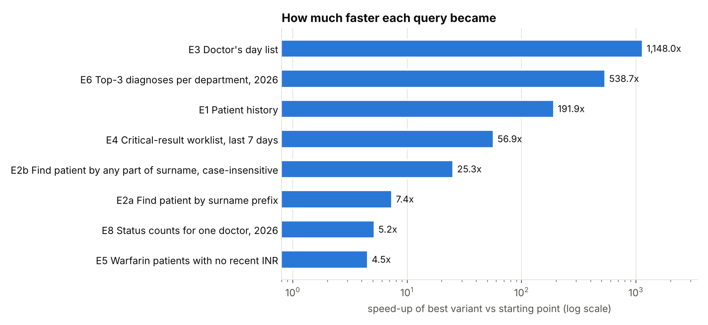

# Portfolio 2 — Query Processing and Optimisation

**Organisation:** Wayne's Clinic Baltimore · **Engine:** PostgreSQL 16.15 · **Data volume:** ≈ 2.6 million rows

Portfolio 1 proved the design is correct. This portfolio proves it is fast enough at realistic volume. The database is loaded with two years of synthetic clinic activity. Eleven business queries are written and run, and nine optimisation experiments are measured with `EXPLAIN (ANALYZE, BUFFERS)`. Each experiment compares a "before" state with one or more optimised states, and the cost of every optimisation is recorded alongside its benefit.

| Deliverable | Where |
|---|---|
| SQL queries | [`sql/02_queries.sql`](sql/02_queries.sql) (Q1–Q11) |
| Query results | [`results/02_query_results.txt`](results/02_query_results.txt) |
| Execution plans | [`plans/`](plans/) — 25 full `EXPLAIN (ANALYZE, BUFFERS)` plans |
| Indexing / optimisation evidence | [`results/benchmark_summary.md`](results/benchmark_summary.md), [`scripts/benchmark.py`](scripts/benchmark.py), [`sql/03_recommended_indexes.sql`](sql/03_recommended_indexes.sql) |
| Performance analysis | §5 and [`charts/`](charts/) |

---

## 1. Test environment and data

`sql/01_bulk_load.sql` extends the Portfolio 1 sample with deterministic synthetic data (`setseed`). The result is 50,000 patients and 200 doctors, with every weekday clinic session from January 2025 to December 2026 filled to about 40%. Patient choice is mildly skewed so some patients are frequent attenders. Rows are inserted in time order, as a live system would write them.

| Table | Rows | | Table | Rows |
|---|---:|---|---|---:|
| patient | 50,020 | | prescription | 274,165 |
| doctor | 200 | | prescription_item | 546,426 |
| appointment | 591,231 | | lab_order | 160,500 |
| diagnosis | 590,059 | | lab_result | 401,731 |

Server: PostgreSQL 16.15 on Ubuntu 24.04, 2 vCPU, 7 GB RAM, default `shared_buffers = 128MB`, `work_mem = 4MB`, `random_page_cost = 4`. JIT was switched off for the measurements because its compile time adds noise to sub-second queries. Every timing is the **median of 7 runs after a warm-up run**, so results reflect a warm cache, which is what an outpatient system serving the same working set all day experiences.

## 2. How PostgreSQL processes a query

Every query passes through four stages. The patient-history query (Q3) shows all of them.

1. **Parser** checks syntax and builds a parse tree. `SELECT … FROM v_patient_history WHERE patient_id = 83` is syntactically just a select from a relation.
2. **Analyser / rewriter** resolves names against the catalogue. Because `v_patient_history` is a view, the rule system **replaces it with its definition**: a `UNION ALL` of four branches covering appointments, diagnoses, prescriptions and lab results.
3. **Planner / optimiser** pushes the predicate `patient_id = 83` down into each branch. It then estimates the cost of alternative access paths (sequential scan, index scan, bitmap scan) and join methods (nested loop, hash, merge) from table statistics in `pg_statistic`, and keeps the cheapest plan. Costs are in abstract units derived from `seq_page_cost`, `random_page_cost` and `cpu_*_cost`.
4. **Executor** runs the plan as a tree of iterators. Each node pulls rows from its children (the Volcano model), and nodes such as `Gather` and `Parallel Append` hand work to parallel workers.

`EXPLAIN` shows the plan chosen in step 3. `EXPLAIN ANALYZE` also runs it and reports, for each node, the estimated rows next to the **actual** rows, the time, and with `BUFFERS` how many 8 KB pages came from shared memory (`hit`) or the operating system (`read`). Comparing estimated and actual rows is the first diagnostic for a bad plan.

## 3. The business queries (Q1–Q11)

All eleven run against the bulk data; full output is in [`results/02_query_results.txt`](results/02_query_results.txt).

| # | Who asks | Question | SQL techniques |
|---|---|---|---|
| Q1 | Reception | Which of this doctor's slots are free today? (booking) | `generate_series` slot grid, range overlap `&&`, `NOT EXISTS` anti-join |
| Q2 | Reception | Find a patient by surname prefix and birth year | `LIKE 'prefix%'`, range predicate |
| Q3 | Doctor | Full history of one patient (core operation) | 4-branch `UNION ALL` view, predicate push-down |
| Q4 | Doctor | My appointment list for one day | sargable range on `timestamptz`, join |
| Q5 | Laboratory | Critical results filed in the last 7 days | 6-table join, selective filter |
| Q6 | Management | Top 3 primary diagnoses per department, 2026 | CTE, `GROUP BY`, `rank()` and `sum() OVER (PARTITION BY …)` |
| Q7 | Operations | Doctors with the highest no-show rates | `count(*) FILTER (WHERE …)`, `HAVING`, `nullif` |
| Q8 | Patient safety | Patients on warfarin with no INR test in 90 days | correlated `NOT EXISTS` across 4 tables |
| Q9 | Recall | Diabetics whose last visit was > 6 months ago | `DISTINCT ON`, semi-join, date arithmetic |
| Q10 | Management | Monthly completed visits by department | `date_trunc`, conditional aggregation (pivot) |
| Q11 | Pharmacy | 30-day demand vs stock on hand (reorder) | aggregation + `CASE` business rule |

Example outputs:





Q8 is a good example of SQL answering a patient-safety question: 5,450 patients had warfarin in the last 180 days but no INR test in the last 90. (Synthetic data: the generator does not link INR tests to warfarin, so the number is high. Real data would be lower, but the query is the same.)

## 4. Optimisation experiments

`scripts/benchmark.py` puts the database into each "before" state, measures, applies the change and measures again. The full plans for every variant are in [`plans/`](plans/).



### E1 — Patient history: index the foreign keys (192× faster)

**Problem.** PostgreSQL creates indexes for primary keys and `UNIQUE` constraints but **not for foreign keys**. To find one patient's events, the planner had to `Parallel Seq Scan` all 591,231 appointments and all 274,165 prescriptions, then hash-join them.

**Change.** Three B-tree indexes: `appointment(patient_id, scheduled_start)`, `prescription(appointment_id)`, `lab_order(appointment_id)`. The diagnosis and lab-result branches were already served by the leading column of their composite `UNIQUE` constraints, a nice side effect of the Portfolio 1 key design.

**Result.** 120.9 ms → **0.63 ms**. Buffers fell from 30,041 pages (12,899 read from outside shared memory) to 446, all cache hits. The plan changed from parallel sequential scans to `Bitmap Index Scan on ix_appt_patient_start` in every branch, whose handful of appointments then drive index lookups into `prescription`, `lab_order`, `diagnosis` and `lab_result` (the 200-row `doctor` table is simply hashed).




### E2 — Patient search: the right *kind* of index

**E2a, prefix search** (`last_name LIKE 'Okonk%'`). A plain B-tree on `last_name` was created **and ignored** (3.18 ms → 3.15 ms, still a `Seq Scan`). The database collation is `C.UTF-8`, and in PostgreSQL 16 only the `C`/`POSIX` collations let an ordinary B-tree serve `LIKE`. Rebuilding the index with the `varchar_pattern_ops` operator class, which compares strings byte by byte, made it usable: **0.43 ms (7.4×)**. Creating an index is not the same as having a useful index; the plan must be checked.

**E2b, infix and case-insensitive search** (`ILIKE '%konk%'`) cannot use any B-tree, because there is no fixed prefix. A **GIN trigram index** (`pg_trgm`) breaks names into three-letter fragments: 19.4 ms → **0.77 ms (25×)**.

### E3 — Doctor's day list: sargability (1,148× faster)

| Variant | Median | Plan |
|---|---:|---|
| `(scheduled_start AT TIME ZONE …)::date = '2026-10-20'`, no index | 28.7 ms | Seq Scan, 591k rows |
| `scheduled_start >= … AND < …` (range), no index | 29.1 ms | Seq Scan |
| Date cast + index `(doctor_id, scheduled_start)` | 2.9 ms | index used for `doctor_id` only; 2,917 rows removed by filter |
| **Range + index** | **0.025 ms** | Index Scan, both columns in `Index Cond` |

A predicate is *sargable* (Search ARGument-able) when the indexed column appears bare on one side of the comparison. Wrapping `scheduled_start` in a function hides it from the index, so only the first column (`doctor_id`) could be used and every one of the doctor's 2,924 appointments had to be checked. Rewriting the condition as a half-open range lets both index columns be used, and the query reads 30 buffer pages.



### E4 — Critical-results worklist: BRIN vs partial index

The worklist needs critical results (`abnormal_flag = 'C'`, 0.7% of rows) from the last 7 days.

| Index | Median | Size |
|---|---:|---:|
| none (Seq Scan of 401,731 rows) | 25.2 ms | — |
| BRIN on `resulted_at` | 2.47 ms | **24 KB** |
| **Partial B-tree `(resulted_at) WHERE abnormal_flag = 'C'`** | **0.44 ms** | 80 KB |
| (the lab_result table itself) | | 26.8 MB |

A **BRIN** index stores only the min/max timestamp of each block range. Because results arrive in time order it can skip almost the whole table, but the bitmap is lossy (84 lossy heap blocks, 4,833 rows rejected by the filter). The **partial index** contains only the 2,853 critical rows, so it answers exactly the question asked. It was adopted. BRIN stays the right tool for broad time-range scans if the table grows to hundreds of millions of rows.

### E5 — Anti-join rewrite (4.5× faster)

"Patients on warfarin with **no** recent INR" was written three ways:

| Form | Median | What the executor does |
|---|---:|---|
| `(SELECT count(*) …) = 0` correlated subquery | 463 ms | Runs `SubPlan 1` once per candidate row: 471,306 buffer hits |
| `patient_id NOT IN (SELECT …)` | 218 ms | Builds a `hashed SubPlan` once, probes it per row |
| **`NOT EXISTS (SELECT …)`** | **102 ms** | Planner converts it into a single `Parallel Hash Right Anti Join` |

`NOT EXISTS` is preferred for correctness as well as speed. `NOT IN` returns no rows at all if the subquery ever yields a `NULL`, and it can only be hashed while the subquery result fits in `work_mem`.

### E6 — Dashboard: materialised view (539× faster)

Q6 aggregates 590,059 diagnoses across a 4-table join every time the management dashboard loads (222 ms). The materialised view `mv_dept_dx_month` pre-aggregates diagnoses by department, month and ICD-10 code (926 rows), so the dashboard query takes **0.41 ms**. The cost is staleness: `REFRESH MATERIALIZED VIEW CONCURRENTLY` takes **644 ms** and is scheduled nightly. `CONCURRENTLY` needs the unique index `ux_mv_dept_dx_month` and lets readers keep using the old contents during a refresh.

### E7 — Does the cost-based optimiser choose well?

A 590k × 590k join (appointment ⋈ diagnosis, grouped by month), with each join algorithm forced in turn:

| Strategy | Median |
|---|---:|
| Planner's choice: **Parallel Hash Join** | 317 ms |
| Forced Merge Join (`enable_hashjoin = off`) | 291 ms |
| Forced Nested Loop (`enable_hashjoin = off`, `enable_mergejoin = off`) | 501 ms (1.83 million buffer hits) |
| Planner's choice with `random_page_cost = 1.1` | 322 ms |

The planner's choice was within 9% of the best forced plan and avoided the nested loop, which is 1.6× slower. The small gap to the merge join comes from the default `random_page_cost = 4`, which models spinning disks and over-prices index scans on cached data. Lowering it to an SSD-appropriate 1.1 changed the plan: an index-only scan of the partial unique index `ux_diagnosis_one_primary` replaced the diagnosis table scan, but not the overall time. **Conclusion:** at this scale the default cost model is good enough, and changing planner settings globally is not justified by this evidence.

### E8 — Covering index → index-only scan (5.2× faster)

Counting a doctor's appointments by status for 2026 with index `(doctor_id, scheduled_start)` still visited the table for every row to read `status` (1.84 ms, 1,380 buffers). Adding `INCLUDE (status, patient_id)` stores those columns in the index leaf pages. After a `VACUUM` updated the visibility map, the plan became an **Index Only Scan with `Heap Fetches: 0`**: 0.36 ms and 11 buffers. The same covering index also serves the Q4 day list (E3), so one index replaces two.



### E9 — What indexes cost on the write path



Inserting 100,000 appointments took 191 ms with only a primary key, 649 ms with three B-tree indexes, and **5,484 ms** once the two GiST exclusion constraints were added. The exclusion constraints, which give the clinic its guarantee against double booking, make each insert about 8× more expensive than the B-trees do. For the clinic that is an easy trade: it books a few thousand appointments a day (milliseconds of total cost) and reads them millions of times. For a high-volume ingest table such as device telemetry, the same design would be wrong.

## 5. Performance analysis



1. **The biggest wins came from matching the index to the access pattern, not from adding more indexes.** E1, E3 and E8 needed composite indexes whose column order matches the query: equality column first, range column second.
2. **Query shape matters as much as indexing.** E3 (sargable rewrite) and E5 (`NOT EXISTS`) gained 100× and 4.5× from rewriting alone. Sargability decided whether the E3 index could be used at all.
3. **Specialised index types earn their place.** GIN trigram for fuzzy search, BRIN for append-only time series, partial indexes for small hot subsets, and `INCLUDE` for index-only scans.
4. **Pre-computation is the right answer for analytics.** A 539× faster dashboard costs a 644 ms nightly refresh and data that is up to a day old, which management reports tolerate and clinical screens would not.
5. **Every optimisation has a price.** The recommended set adds about 51 MB of indexes and slows inserts. The extra write cost is negligible at clinic volumes, but it is why four tested indexes were *not* adopted (listed at the end of [`sql/03_recommended_indexes.sql`](sql/03_recommended_indexes.sql)).

**Recommended physical design** (applied by `sql/03_recommended_indexes.sql`): `ix_appt_patient_start`, `ix_prescription_appt`, `ix_lab_order_appt`, `ix_patient_last_pattern`, `ix_patient_last_trgm`, `ix_appt_doctor_start_cov`, `ix_lab_result_critical`, and the materialised view `mv_dept_dx_month`.

## 6. Two query-processing lessons from building this portfolio

- **Volatile functions in an uncorrelated `LATERAL` subquery.** The first version of the data generator used `CROSS JOIN LATERAL (SELECT random() …)`. Because that subquery referenced no outer column, the planner evaluated it **once** and materialised the result, so every prescription received the same two drugs. Adding a reference to the outer row (`random() + 0 * p.prescription_id`) forces one evaluation per row. It is a reminder that the planner may legally reorder or cache anything it can prove is independent of the outer query.
- **Collation-dependent index usability.** E2a was discovered, not planned. The index existed, but the plan showed it was never used.

## 7. Reproduce

```bash
cd Portfolio-1-Database-Design-and-Modelling && ./run_portfolio1.sh && cd ..
cd Portfolio-2-Query-Processing-and-Optimisation && ./run_portfolio2.sh
```

The bulk load takes about two minutes and the benchmark about three. Absolute timings will differ on other hardware; the before/after ratios and plan shapes are the evidence.
