# Portfolio 3 — Transactions and Concurrency

**Organisation:** Wayne's Clinic Baltimore · **Engine:** PostgreSQL 16 (MVCC, Serializable Snapshot Isolation)

A hospital database is written by many people at once. Receptionists book, doctors diagnose, pharmacists dispense and the lab files results. This portfolio shows, on a real server, what transactions guarantee, what goes wrong without the right isolation or locking, and which mechanism fixes each problem. Every demonstration opens genuine concurrent sessions, each a separate PostgreSQL backend process, and interleaves their statements in a fixed order so the outcome is reproducible.

| Deliverable | Where |
|---|---|
| Commit, rollback, savepoint, atomicity on error | §2 · [`sql/01_commit_rollback_savepoint.sql`](sql/01_commit_rollback_savepoint.sql) |
| Isolation levels (dirty / non-repeatable / phantom reads) | §3 · C1–C3 |
| Concurrency problems and control mechanisms | §4 · C4–C7 (lost update, write skew, double booking, deadlock) |
| MVCC and durability | §5 · C8, C9 |
| Screenshots / output evidence | [`evidence/`](evidence/): a `.txt` log with millisecond timestamps and a two-column timeline `.png` per demo |

---

## 1. Transactions in one paragraph

A transaction is a unit of work that the database treats as indivisible. **ACID** names its guarantees. *Atomicity*: all of its changes happen or none do. *Consistency*: it moves the database from one state that satisfies every constraint to another. *Isolation*: concurrent transactions do not see each other's half-finished work, to a degree set by the isolation level. *Durability*: once `COMMIT` returns, the change survives a crash. PostgreSQL implements isolation with **multi-version concurrency control (MVCC)**: an update writes a new row version instead of overwriting, and each transaction reads from a *snapshot*. Readers therefore never block writers and writers never block readers. Only writers competing for the same row wait for each other.

## 2. Commit, rollback and savepoints (single session)

Full output: [`evidence/01_commit_rollback_savepoint_output.txt`](evidence/01_commit_rollback_savepoint_output.txt).

| Demo | Scenario | What it proves |
|---|---|---|
| **T1 COMMIT** | A walk-in patient is registered *and* booked in one transaction. After `COMMIT`, a brand-new connection sees both rows, stamped with the creating transaction id (`xmin`). | Committed work is visible to everyone and permanent |
| **T2 ROLLBACK** | A pharmacist removes 100 insulin pens instead of 10 and also writes an audit row, then cancels. | `ROLLBACK` undoes *every* statement in the transaction, the audit row included |
| **T3 Atomicity on error** | James Holloway walks into the Emergency Department on a Sunday. The doctor stores a diagnosis, then prescribes penicillin, to which he is allergic. The trigger raises `WC001`. The transaction enters the *aborted* state; even `SELECT` is refused (`25P02`) and `COMMIT` becomes `ROLLBACK`. | The diagnosis written *before* the error is discarded too: all or nothing |
| **T4 SAVEPOINT** | Same consultation with `SAVEPOINT before_line_1`. After the allergy error, `ROLLBACK TO SAVEPOINT` undoes only the bad line; azithromycin is prescribed instead and the transaction commits. | Partial rollback keeps valid work inside a long transaction |
| **T5 Sequences** | An appointment insert is rolled back but the identity sequence still advances. | Sequences are deliberately non-transactional, so ids have gaps and must never be used as counts |

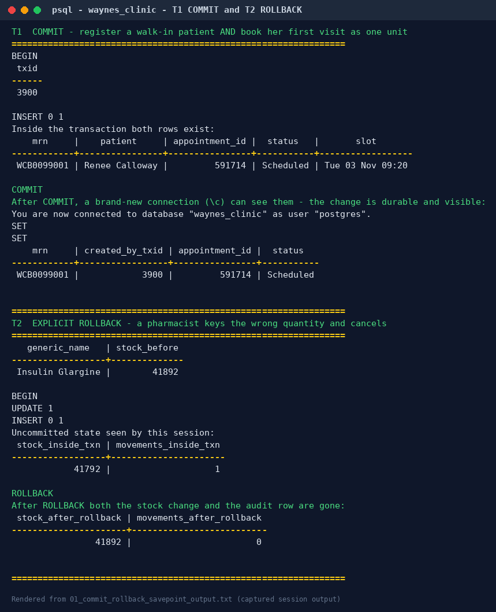

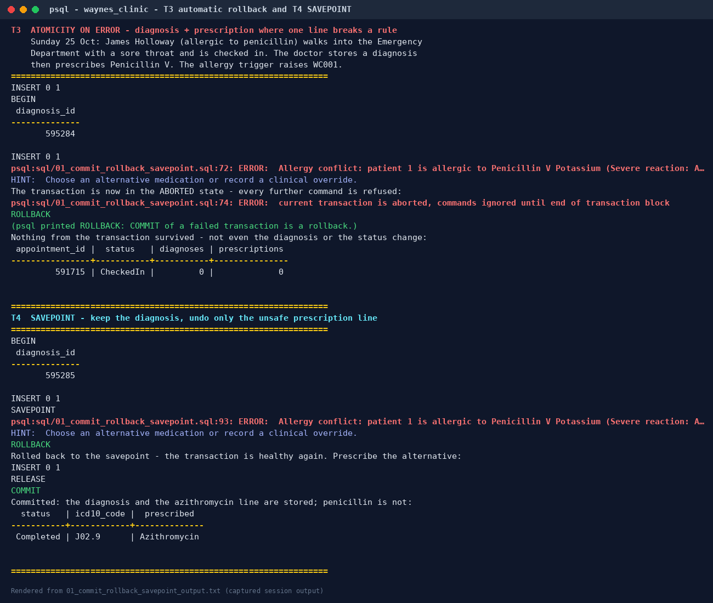

## 3. Isolation levels and read anomalies

The SQL standard defines four isolation levels by the anomalies each permits. PostgreSQL implements three distinct behaviours, and these demos test each claim.

### C1 — Dirty read (READ UNCOMMITTED)

The lab scientist (A) changes a potassium result to 6.9 but does not commit. The doctor (B), at `READ UNCOMMITTED`, reads the result and sees **3.3**, the committed value. PostgreSQL treats READ UNCOMMITTED as READ COMMITTED, so **dirty reads are impossible at every level**.

### C2 — Non-repeatable read

Doctor A reads Tyrone Jackson's INR twice in one transaction while the lab (B) corrects it from 2.1 to 3.6 and commits.

| Isolation | A's 1st read | A's 2nd read | Anomaly |
|---|---|---|---|
| READ COMMITTED | 2.1 | **3.6** | **Yes**: a new snapshot is taken for every statement |
| REPEATABLE READ | 2.1 | 2.1 | No: one snapshot for the whole transaction |

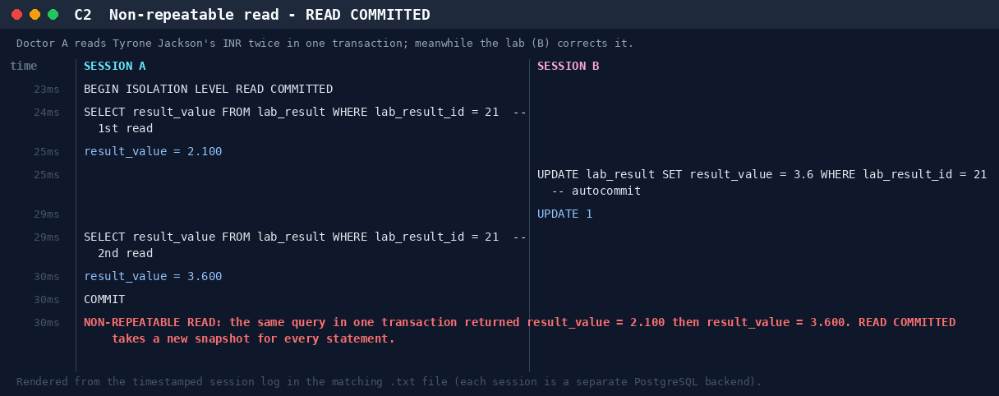

### C3 — Phantom read

A manager counts Dr Raman's bookings for a day twice while a receptionist books a new slot.

| Isolation | 1st count | 2nd count | Anomaly |
|---|---|---|---|
| READ COMMITTED | n | **n + 1** | **Yes**: a new row appeared |
| REPEATABLE READ | n | n | No: PostgreSQL's repeatable read is snapshot isolation, which also stops phantoms (stricter than the standard requires) |

## 4. Concurrency problems and control mechanisms

### C4 — Lost update: two pharmacists dispense the same drug

Insulin stock is 10. Pharmacist A dispenses 3 and B dispenses 4, so the correct final stock is **3**.

| Variant | Mechanism | Final stock | Evidence |
|---|---|---|---|
| **C4a** read value → compute in app → write back (READ COMMITTED) | none | **6 — LOST UPDATE** | [log](evidence/C4a_lost_update.txt) |
| C4b `SELECT … FOR UPDATE` | pessimistic row lock: B waited **410 ms** until A committed, then read 7 | 3 | [log](evidence/C4b_select_for_update.txt) |
| C4c `UPDATE … SET stock = stock - n` | atomic update: B queued on A's row lock, then re-evaluated against the new version | 3 | [log](evidence/C4c_atomic_update.txt) |
| C4d same code at REPEATABLE READ | first-updater-wins: B got `40001 could not serialize access due to concurrent update`, retried and succeeded | 3 | [log](evidence/C4d_repeatable_read_retry.txt) |
| C4e compare-and-set `UPDATE … WHERE stock_on_hand = <value read>` | optimistic: B's update matched 0 rows, so it re-read and retried; no locks held while the user thinks | 3 | [log](evidence/C4e_optimistic_cas.txt) |

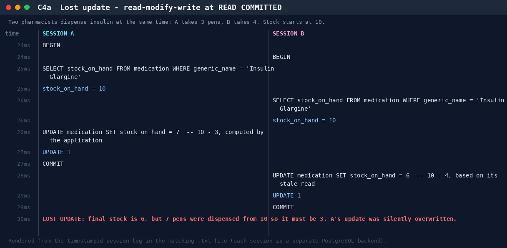

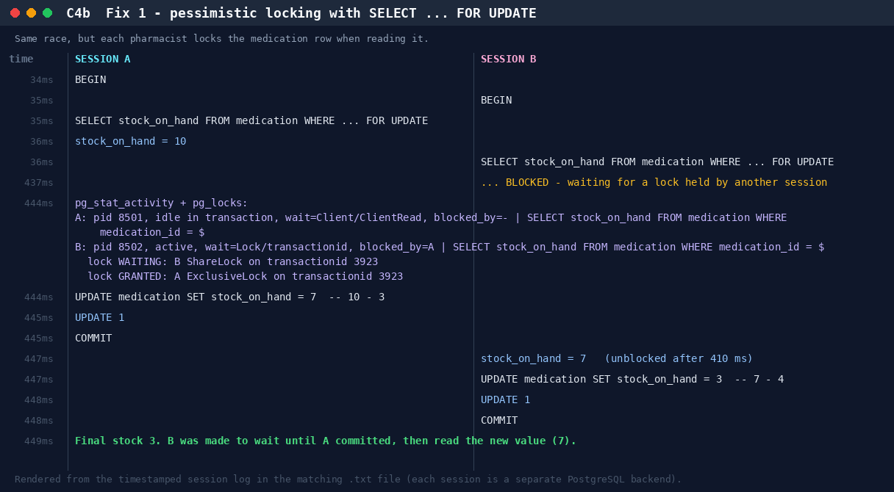

The monitor session in C4b reads `pg_stat_activity` and `pg_locks` while B is blocked. It shows B `waiting on Lock/transactionid`, `blocked_by = A`: the lock is visible inside the server, not just inferred from timing.

**Which fix should the clinic use?** The atomic `UPDATE` (C4c) is simplest when the new value can be computed in SQL. `dispense_prescription()` uses `SELECT … FOR UPDATE` (C4b) because it must check stock *before* deciding to dispense. Optimistic control (C4e) suits web screens where a user may hold a form open for minutes.

### C5 — Write skew: the on-call rule

Rule: at least one doctor must stay on call. Dr Fairbanks (A) and Dr Whitfield (B) each check that 2 doctors are on call, and each then signs *themselves* off. The two transactions update **different rows**, so there is no write-write conflict for row locks to catch.

| Isolation | Outcome |
|---|---|
| REPEATABLE READ | Both commit. **0 doctors on call: the invariant is broken** (write skew is allowed by snapshot isolation) |
| **SERIALIZABLE** | B fails with `40001 could not serialize access due to read/write dependencies among transactions`. On retry B sees only 1 doctor on call and is refused. **1 doctor remains on call.** |

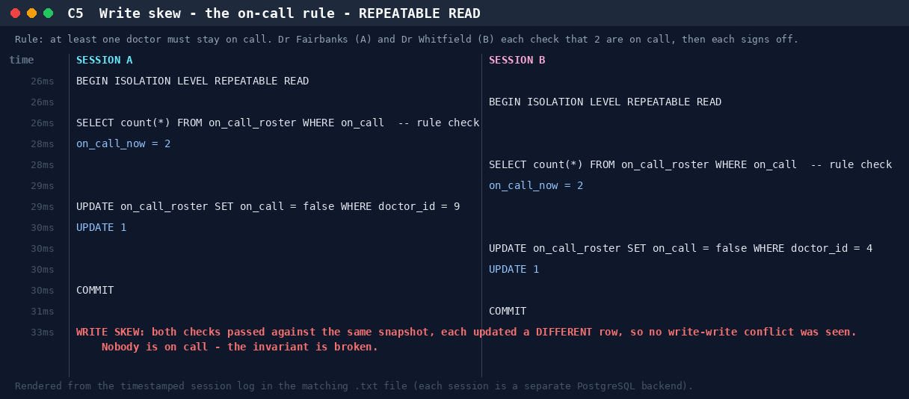

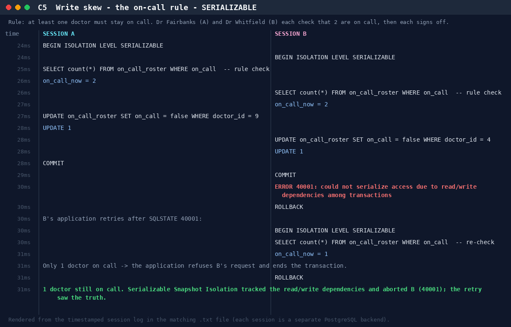

PostgreSQL's SERIALIZABLE level uses **Serializable Snapshot Isolation (SSI)**. It records which rows each transaction read (predicate locks) and aborts one transaction when a dangerous cycle of read/write dependencies appears. The application must be ready to retry on `40001`. That is the price of a guarantee no `CHECK` constraint can express.

### C6 — Double booking: application check vs database constraint

| Variant | Outcome |
|---|---|
| **C6a** "Is the slot free? Then insert" on a table with no constraint | Both receptionists see 0 clashes and both insert: **2 patients in one slot** |
| **C6b** `book_appointment()` on the real table (`EXCLUDE` constraint) | B **blocks** (it cannot know if the slot is taken until A finishes). A commits, and B immediately gets `23P01 Slot taken` |
| **C6c** Same, but A rolls back | B's booking succeeds once A's tentative row disappears |

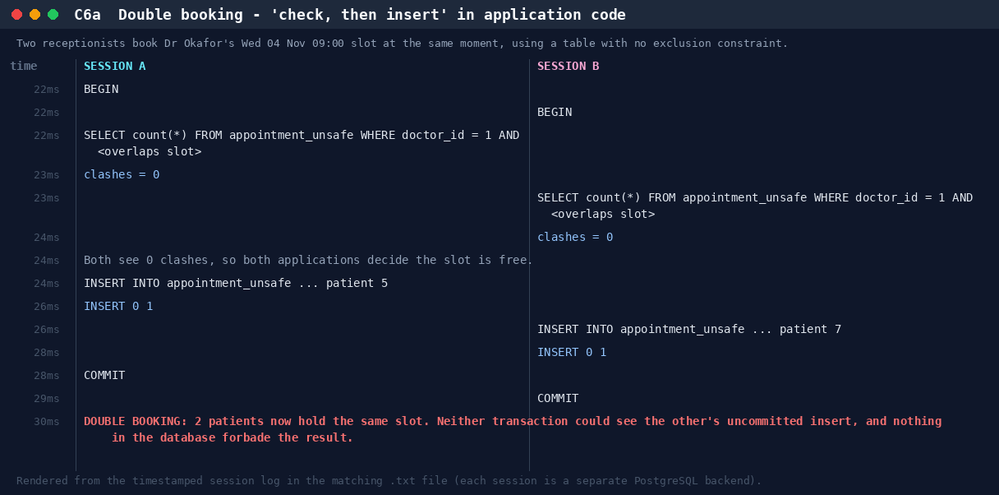

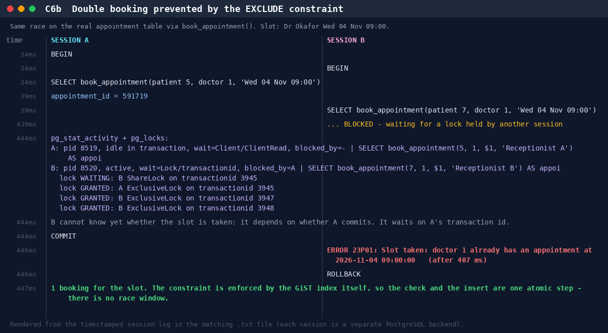

This is the strongest argument for declaring rules in the schema (Portfolio 1). The exclusion constraint makes "check" and "insert" one atomic step inside the index, so there is no race window. Waiting instead of failing fast (C6c) is also correct: the conflicting row might never commit.

### C7 — Deadlock: detection and prevention

A moves stock insulin → albuterol while B moves albuterol → insulin. Each locks its first row, then waits for the other's: a cycle.

- **C7a.** After `deadlock_timeout` (1 s), PostgreSQL's deadlock detector found the cycle and aborted A with `40P01 deadlock detected`; B completed. The server log records both processes and the lock each was waiting for (included in the evidence).
- **C7b. Prevention.** Both transfers first lock *both* rows with `ORDER BY medication_id FOR UPDATE`. A consistent global lock order turns the cycle into a queue: B waited about 400 ms and both committed. `dispense_prescription()` applies the same rule.

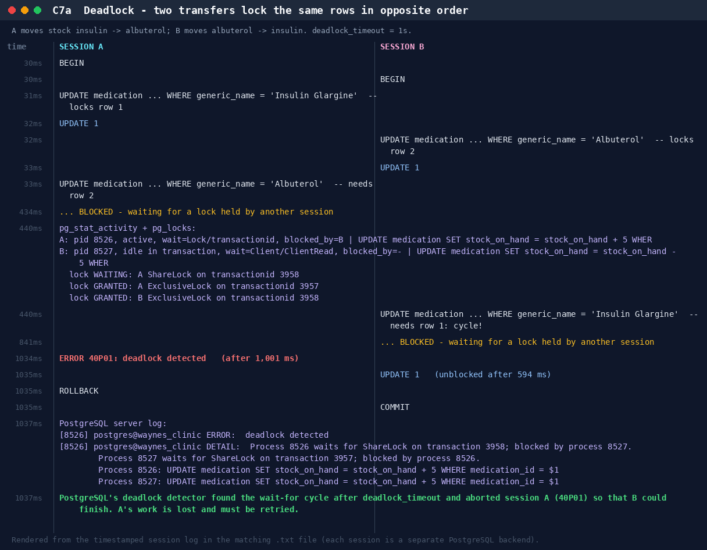

## 5. MVCC and durability

**C8 — Row versions.** A opens a REPEATABLE READ snapshot and reads insulin stock 10 at physical location `ctid (0,72)`, created by transaction 3961. B updates the stock to 99 **without waiting** and creates a new version at `(0,73)`. The old version's `xmax` is now B's transaction id, yet A, inside its snapshot, still reads 10 from `(0,72)`, and a fresh session C sees 99 at `(0,73)`. Two versions of one row coexist until `VACUUM` removes the dead one.

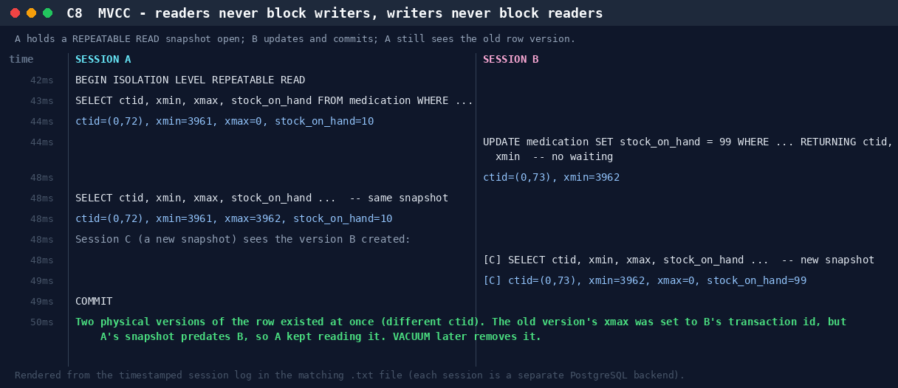

**C9 — Durability: a real crash test.** Session A commits a stock movement; session B inserts another row but never commits. The server is then killed with `pg_ctl stop -m immediate` (no checkpoint, equivalent to a power cut) and restarted. The server log shows *"database system was not properly shut down; automatic recovery in progress … redo starts … redo done"*. Afterwards **only the committed row exists**. `COMMIT` returned only after the commit record was flushed to the write-ahead log (`synchronous_commit = on`), so WAL replay restored it. B's transaction never committed, so its row is invisible.

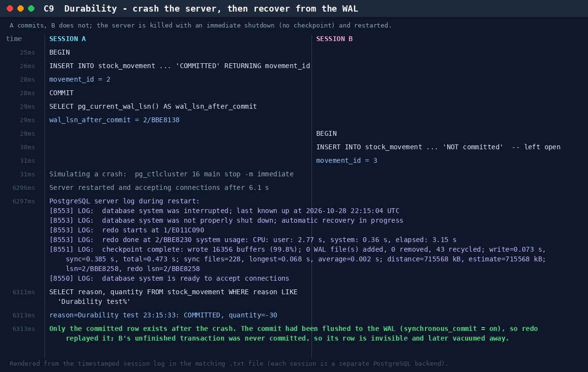

## 6. Results matrix

What was **observed** on PostgreSQL 16 ([`evidence/concurrency_summary.md`](evidence/concurrency_summary.md)):

| Anomaly | READ COMMITTED (default) | REPEATABLE READ | SERIALIZABLE |
|---|---|---|---|
| Dirty read | prevented (C1) | prevented | prevented |
| Non-repeatable read | **occurs** (C2) | prevented (C2) | prevented |
| Phantom read | **occurs** (C3) | prevented (C3) | prevented |
| Lost update (read-modify-write) | **occurs** (C4a) | detected → `40001` (C4d) | detected → `40001` |
| Write skew | **occurs** | **occurs** (C5) | detected → `40001` (C5) |

**Recommendations for Wayne's Clinic.**

1. Keep READ COMMITTED as the default for its throughput, and make every multi-row read-modify-write either an atomic `UPDATE` or a `SELECT … FOR UPDATE`.
2. Use SERIALIZABLE, with automatic retry on `40001`, for the few transactions that protect a cross-row invariant: the on-call roster, bed allocation and controlled-drug registers.
3. Enforce booking rules with constraints, not application checks.
4. Lock rows in a fixed order to avoid deadlocks, and treat `40P01` as retryable.
5. Keep `synchronous_commit = on` for clinical data.

## 7. Reproduce

```bash
./run_portfolio3.sh                 # needs Portfolio 1 loaded; Portfolio 2 data optional
SKIP_CRASH_TEST=1 ./run_portfolio3.sh   # skip the server restart on shared machines
```

`scripts/session_lab.py` is a small harness: each `Session` is its own connection, `.start()` sends a statement expected to block in a background thread, and `Monitor.snapshot()` reads `pg_stat_activity`/`pg_locks` while it waits. The timelines are drawn from the same timestamped events as the `.txt` logs.
