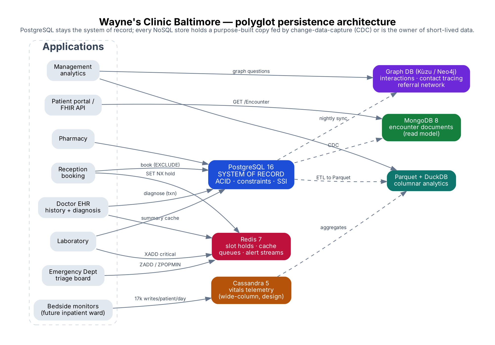
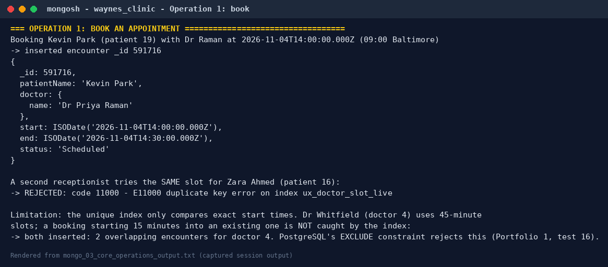
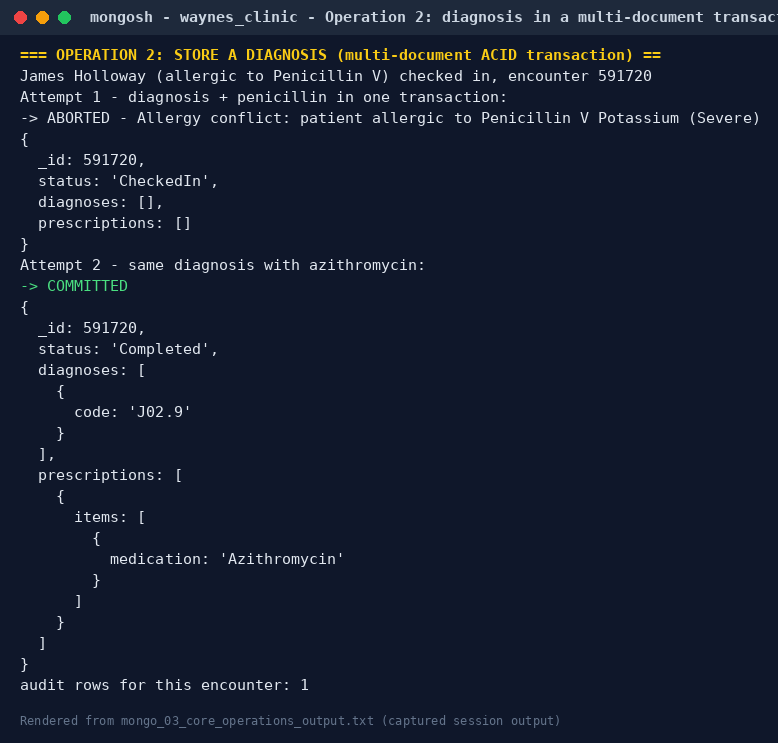
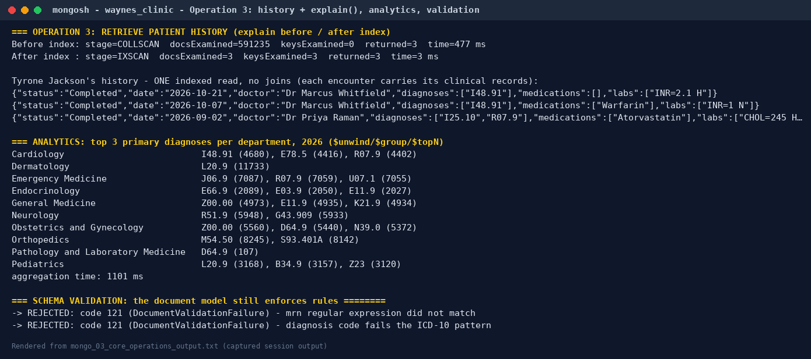
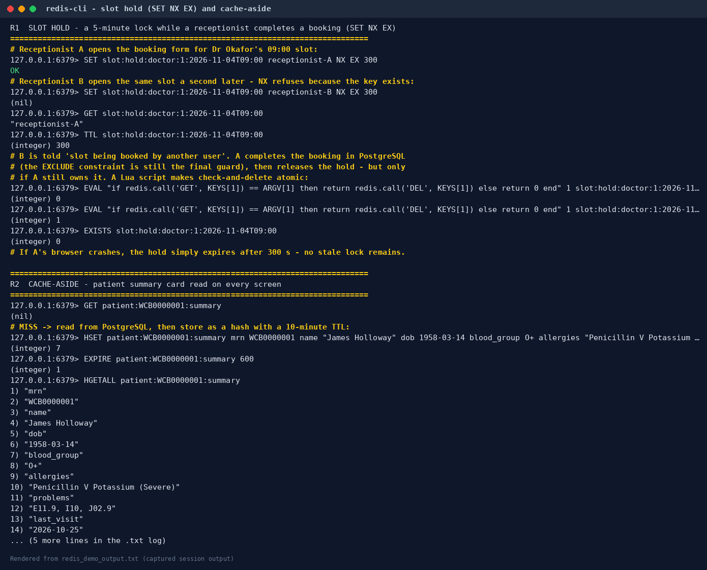
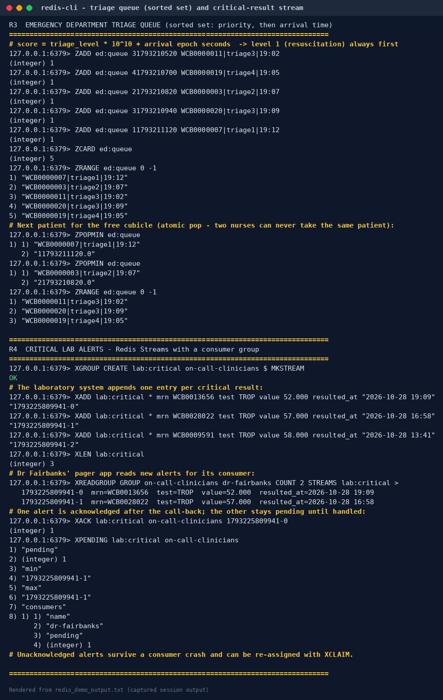
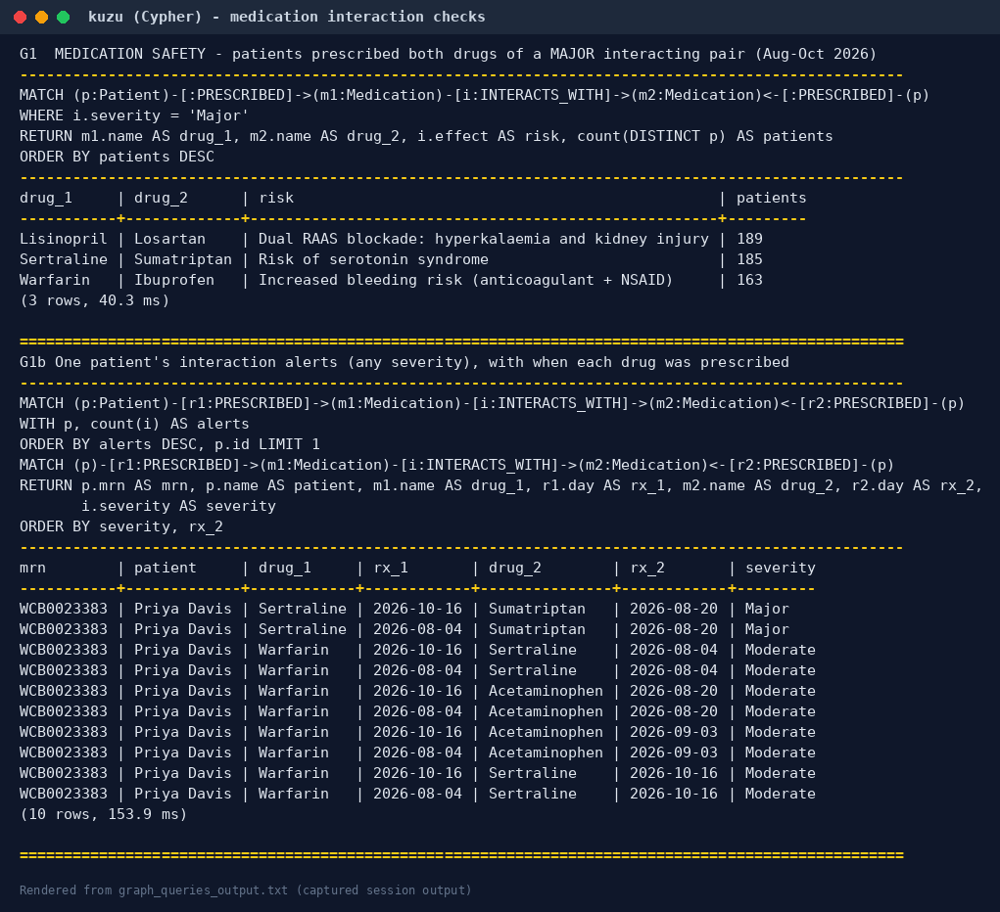
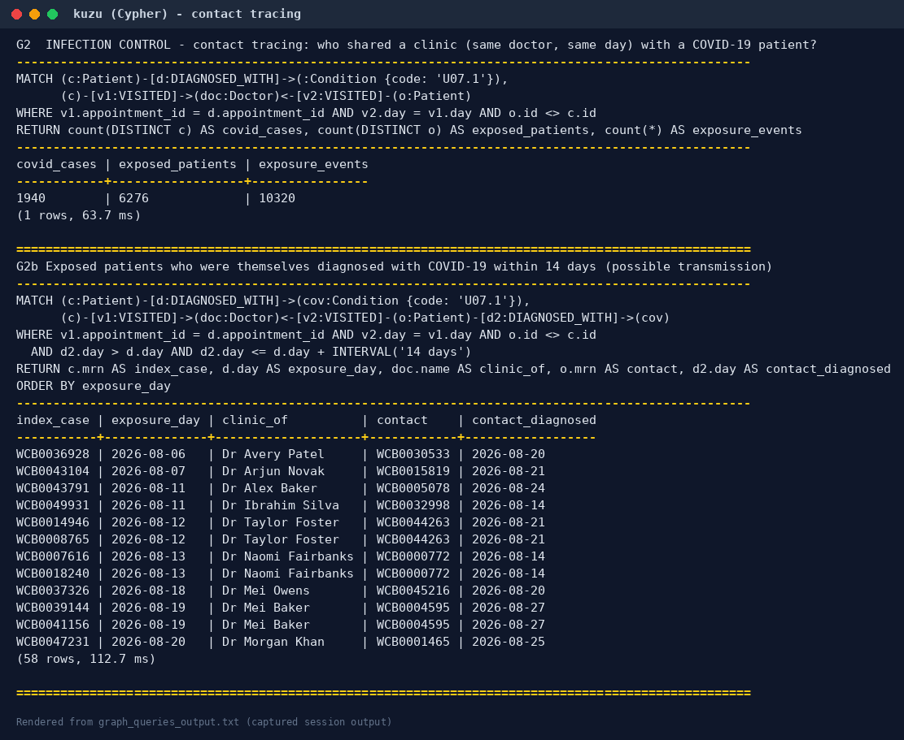
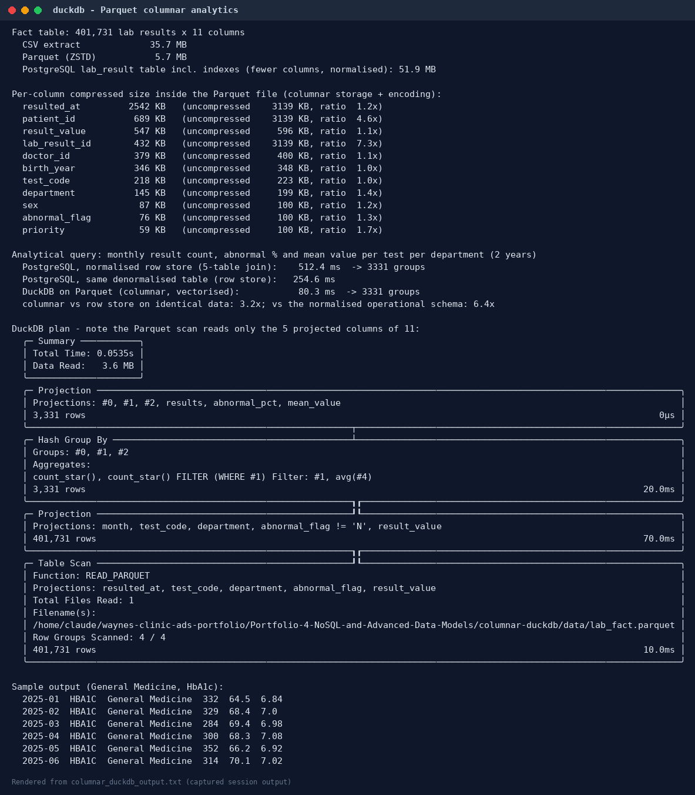

# Portfolio 4 — NoSQL and Advanced Data Models

**Organisation:** Wayne's Clinic Baltimore · **Engines:** MongoDB 8.0.23 · Redis 7 · Kùzu 0.11 (Cypher property graph) · DuckDB + Parquet · Apache Cassandra 5 (design)

The same clinic, the same data and the same three core operations, modelled four more ways. Every model except Cassandra was **built and executed**: the data was migrated from the Portfolio 1–2 PostgreSQL database, and the queries, explains and timings below are captured output. Cassandra is a query-first design only, because its binaries could not be downloaded in the build environment, and is labelled as such.

| Model | Store | What it is used for here | Folder |
|---|---|---|---|
| **Document** | MongoDB 8 (replica set) | Encounter documents with embedded diagnoses, prescriptions and lab results; booking, diagnosis transaction, history | [`document-mongodb/`](document-mongodb/) |
| **Key-value** | Redis 7 | Slot holds, cache-aside summary card, emergency triage queue, critical-result stream | [`key-value-redis/`](key-value-redis/) |
| **Graph** | Kùzu (Cypher) + Neo4j script | Drug interactions, contact tracing, referral network, comorbidity, shortest paths | [`graph-cypher/`](graph-cypher/) |
| **Column** | DuckDB on Parquet (executed); Cassandra CQL (design) | Columnar analytics; wide-column booking, timeline and telemetry tables | [`columnar-duckdb/`](columnar-duckdb/), [`column-family-cassandra/`](column-family-cassandra/) |



---

## 1. Document model — MongoDB

### 1.1 From tables to documents

A document database stores an aggregate, meaning the data that is read and written together, as one document. The modelling question is what to **embed** and what to **reference**:

| Relational tables | Document design | Why |
|---|---|---|
| `doctor` + `doctor_availability` + `specialty` + `department` | one `doctors` document, availability **embedded** | Bounded (≤ 14 sessions), always read together when booking |
| `patient` + `patient_allergy` + `postal_area` | one `patients` document, allergies and address **embedded** | Owned by the patient, needed on every prescribing decision |
| `appointment` + `diagnosis` + `prescription` + `prescription_item` + `lab_order` + `lab_result` + `icd10_code`/`medication`/`lab_test` names | one `encounters` document per appointment, all clinical records **embedded** | The visit is written as a unit and read as a unit (history screen) |
| `appointment.patient_id` | `encounters.patientId` **reference** (+ copied name: extended-reference pattern) | Embedding every visit inside the patient would grow without limit (16 MB document cap) and make every clinician write to the same document |

The migration ([`02_load_from_postgres.py`](document-mongodb/02_load_from_postgres.py)) lets PostgreSQL assemble each document with `json_build_object`/`json_agg`, so the mapping is visible in one SQL statement per collection. It loaded **641,454 documents** in about 60 s: 200 doctors, 50,021 patients and 591,233 encounters. Example documents: [`sample_encounter_document.json`](document-mongodb/sample_encounter_document.json), [`sample_patient_document.json`](document-mongodb/sample_patient_document.json).

**"Schema-less" does not mean "no rules".** Each collection has a `$jsonSchema` validator ([`01_create_collections.js`](document-mongodb/01_create_collections.js)) for MRN format, sex and blood group enums, the ICD-10 code pattern, appointment status and required fields. Invalid inserts and updates are rejected with code 121 (`DocumentValidationFailure`).

### 1.2 The three core operations ([`03_core_operations.js`](document-mongodb/03_core_operations.js))

**Book.** `bookAppointment()` checks the doctor's embedded availability in Baltimore time, takes an id from a counter document, and inserts. A **partial unique index** on `{doctor.id, start}` (live statuses only) rejects a second booking of the same slot with `E11000 duplicate key`. **Limitation, shown in the output:** the index compares only exact start times. A 45-minute slot booked at 13:30 and a second booking at 13:45 both succeed. MongoDB has no equivalent of PostgreSQL's `EXCLUDE … WITH &&` range constraint, so overlap rules depend on a fixed slot grid or application logic.



**Store a diagnosis.** A **multi-document ACID transaction** (`session.withTransaction`, `readConcern: snapshot`, `writeConcern: majority`) reads the encounter and the patient's allergies, updates the encounter (status, diagnoses, prescription) and writes an audit document. Prescribing penicillin to James Holloway aborts the whole transaction, leaving no diagnosis and no audit row. Azithromycin commits.



**Retrieve history.** One indexed query returns every visit with its clinical records already inside; no joins are needed.

| | Plan | Documents examined | Time |
|---|---|---:|---:|
| Before index | `COLLSCAN` | 591,235 | 477 ms |
| After `{patientId: 1, start: -1}` | `IXSCAN` | 3 | 3 ms |



### 1.3 Document vs relational: measured

| Measure (same 300 random patients, warm cache) | PostgreSQL 4-branch history view | MongoDB `find` on encounters |
|---|---:|---:|
| Median latency | 1.25 ms | **0.75 ms** |
| p95 latency | 2.03 ms | **1.11 ms** |
| Storage, clinical data incl. indexes | 487.6 MB | **154.0 MB** (WiredTiger compression; 435.7 MB uncompressed) |
| Top-3 diagnoses per department (2026 analytics) | **222 ms** (Portfolio 2, E6) | 1,101 ms (`$unwind`/`$group`/`$topN`) |

The document model wins the read it was designed for (about 1.7× faster here) and stores the data in a third of the space. It loses ad-hoc analytics, and the booking overlap rule had to be weakened.

## 2. Key-value model — Redis ([`redis_demo.py`](key-value-redis/redis_demo.py))

Redis is used **beside** PostgreSQL for jobs where a key-value store is the right tool; it is never the system of record. The full redis-cli transcript is in [`evidence/redis_demo_output.txt`](evidence/redis_demo_output.txt).

| Use case | Redis structure and commands | Evidence |
|---|---|---|
| **R1 Slot hold** while a receptionist fills in the form | `SET slot:hold:doctor:1:… receptionist-A NX EX 300`. B's `NX` returns `(nil)`. Release uses a Lua compare-and-delete so only the owner can release; an abandoned hold expires on its own | atomic, self-expiring lock |
| **R2 Cache-aside** patient summary card | `HSET` + `EXPIRE 600`, invalidated on change | PostgreSQL 0.324 ms vs Redis 0.151 ms median (2×) |
| **R3 Emergency triage queue** | sorted set, score = triage level × 10¹⁰ + arrival time; `ZPOPMIN` pops the most urgent patient atomically | level-1 arrival at 19:12 is seen before level-3 arrivals from 19:02 |
| **R4 Critical-result alerts** | Stream + consumer group: `XADD`, `XREADGROUP`, `XACK`, `XPENDING` | unacknowledged alerts survive a consumer crash |
| **R5 Live dashboard counters** | `HINCRBY`, `INCR` | atomic, no read-modify-write race |





The cache speed-up is modest (2×) on a lightly loaded local PostgreSQL that answers in a third of a millisecond. The real value of Redis is protecting the database from read storms and providing primitives (TTL locks, priority queues, streams) that are awkward in SQL. **Durability:** this instance runs with `appendonly no` (RDB snapshots only), which is acceptable for holds, caches and counters that can be rebuilt, but not for clinical data (R6).

## 3. Graph model — Cypher ([`build_and_query_graph.py`](graph-cypher/build_and_query_graph.py))

The clinic's last three months (Aug–Oct 2026) as a property graph: 34,665 patients, 200 doctors, 26 conditions and 23 medications, connected by 59,495 `VISITED`, 76,618 `DIAGNOSED_WITH` and 70,356 `PRESCRIBED` relationships, plus `ALLERGIC_TO`, `WORKS_IN` and 14 curated `INTERACTS_WITH` drug-interaction edges ([`interactions.csv`](graph-cypher/interactions.csv); illustrative, not for clinical use). Schema: [`schema.cypher`](graph-cypher/schema.cypher). A Neo4j/AuraDB version of the load and queries is in [`neo4j_version.cypher`](graph-cypher/neo4j_version.cypher).

| Query | Question | Result |
|---|---|---|
| **G1** | Which patients hold both drugs of a *major* interacting pair? | Lisinopril+Losartan 189 patients, Sertraline+Sumatriptan 185, Warfarin+Ibuprofen 163 |
| **G2** | Contact tracing: who shared a clinic (same doctor, same day) with a COVID-19 patient? | 1,940 cases → 6,276 exposed patients, 10,320 exposure events |
| G2b | …and were themselves diagnosed within 14 days? | 58 possible transmission links |
| G3 | Which doctors share the most patients (referral network)? | Emergency Medicine ↔ Pediatrics tops the list |
| G4 | Which conditions co-occur most (comorbidity)? | Hyperlipidemia + hypertension (1,035 patients) |
| **G5** | Shortest chain of shared clinicians linking two patients | Tyrone Jackson → Dr Raman → (patient) → Dr Okafor → Zara Ahmed: 4 hops |
| G6 | Patients most similar to Tyrone Jackson by shared conditions | 3 patients share all three of his codes |





**Graph vs SQL on the same questions.** Run against the same data, both engines returned **identical** contact-tracing answers (1,940 / 6,276 / 10,320). That agreement was itself a useful check: an early Cypher version matched any visit that day rather than the diagnosing visit, and the SQL cross-check exposed it.

| Question | Graph (Kùzu) | SQL (PostgreSQL) | Note |
|---|---:|---:|---|
| G2 contact tracing | **64 ms** | 252 ms | SQL needs a self-join of appointment on doctor and date |
| G5 shortest path, 4 hops | **46 ms**, returns the path | 184 ms, distance only | SQL needs `WITH RECURSIVE` breadth-first search ([`shortest_path_recursive.sql`](graph-cypher/shortest_path_recursive.sql)); returning the path itself is much harder |

## 4. Column models

### 4.1 Columnar analytics — DuckDB on Parquet (executed)

401,731 lab results were extracted with their department and patient attributes into a ZSTD-compressed **Parquet** file. That is **5.7 MB**, against 35.7 MB as CSV, because each column is stored and compressed separately. The same two-year analytical query (monthly count, abnormal percentage and mean value per test per department, 3,331 groups):

| Engine | Median |
|---|---:|
| PostgreSQL, normalised operational schema (5-table join) | 512 ms |
| PostgreSQL, same **denormalised** table (row store) | 255 ms |
| **DuckDB on Parquet** (columnar, vectorised) | **80 ms** |

On identical data the column store was **3.2× faster**; against the operational schema, 6.4×. The DuckDB plan shows why: the scan reads only the 5 projected columns out of 11 (3.6 MB of data).



### 4.2 Wide-column — Apache Cassandra (design, not executed)

[`01_schema.cql`](column-family-cassandra/01_schema.cql) and [`02_operations.cql`](column-family-cassandra/02_operations.cql) model the clinic **query-first**, with one table per access pattern and data duplicated on write:

- `appointments_by_doctor_day`, partition key `(doctor_id, clinic_date)`: the day list is one partition read.
- `slot_claims` plus `INSERT … IF NOT EXISTS`: a lightweight transaction (Paxos) gives compare-and-set booking.
- `patient_timeline`, partition `patient_id`, clustered by `event_time DESC`: history is already sorted on disk.
- `critical_results_by_day`: the lab worklist.
- `vitals_by_patient_day` with TimeWindowCompaction and a 30-day TTL: bedside telemetry at about 17,000 writes per patient per day, the workload Cassandra is built for.

`LOCAL_QUORUM` reads and writes on replication factor 3 give read-your-writes (R + W > N). The trade-offs are stated in the CQL: no joins, no ad-hoc filters (`ALLOW FILTERING` scans the cluster), and no cross-row rules such as "no overlapping appointments".

## 5. Suitability analysis

| Requirement at Wayne's Clinic | Relational (PostgreSQL) | Document (MongoDB) | Key-value (Redis) | Graph | Wide-column (Cassandra) | Columnar (Parquet) |
|---|---|---|---|---|---|---|
| Book without double booking | **Best**: `EXCLUDE` range constraint, atomic | Partial: exact-slot unique index only | Helper: TTL hold | — | LWT on a fixed slot grid | — |
| Store diagnosis + prescription atomically, with allergy check | **Best**: one transaction, constraints and triggers | Good: multi-document transactions (replica set required) | — | — | Logged batch (atomic, not isolated) | — |
| Retrieve patient history | Good (1.25 ms) | **Best** (0.75 ms, one read, no joins) | Cache | — | Good (one partition) | — |
| Ad-hoc analytics / reporting | Good | Weak (1.1 s vs 0.2 s) | — | Relationship analytics | Weak | **Best** |
| Relationship questions (contact tracing, interactions, paths) | Possible, verbose (`WITH RECURSIVE`) | Weak | — | **Best** | — | — |
| Ephemeral, high-rate state (locks, queues, counters, alerts) | Possible | — | **Best** | — | — | — |
| Device telemetry ingest | Possible | Possible (time series) | — | — | **Best** | archive |
| Schema flexibility (e.g. HL7 FHIR resources, which are JSON) | `jsonb` columns | **Best** | — | — | — | — |

**Conclusion.** No single model is best for a hospital. Clinical truth (bookings, diagnoses, prescriptions) needs strong consistency, multi-row constraints and serializable transactions, which is why **PostgreSQL remains the system of record** (Portfolios 1–3). The NoSQL stores earn their place as **purpose-built secondary stores**, fed from PostgreSQL by change-data-capture or batch ETL (diagram above):

- MongoDB for a FHIR-style patient portal and fast history reads.
- Redis for holds, queues and alerts.
- A graph database for infection control and medication-safety analytics.
- Parquet/DuckDB for management reporting.
- Cassandra only if the clinic adds inpatient telemetry.

This is *polyglot persistence*. Its cost is operational: more systems to secure for HIPAA, and copies that are only eventually consistent with the record (Portfolio 5 measures exactly that lag).

## 6. Reproduce

```bash
./run_portfolio4.sh      # needs PostgreSQL with Portfolios 1-2, MongoDB as replica set rs0, Redis, mongosh,
                         # Python: psycopg pymongo redis kuzu duckdb
```

Engines used in the build: MongoDB 8.0.23 (installed from conda-forge as a single-node replica set, which transactions require), Redis 7, Kùzu 0.11.3 and DuckDB 2.0.0 (Python packages). The graph and Parquet extracts are regenerated on each run and excluded from git.
