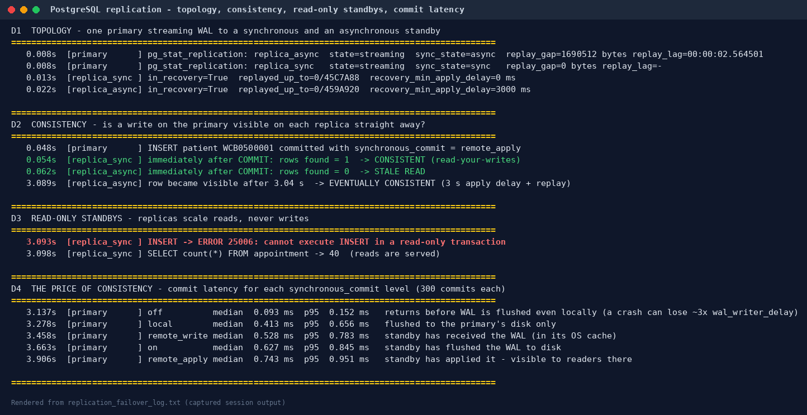
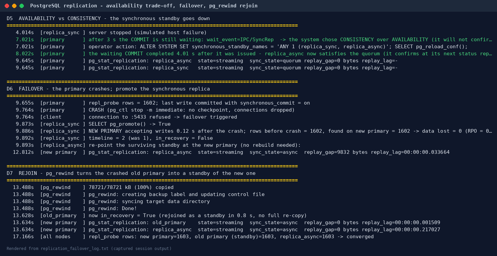
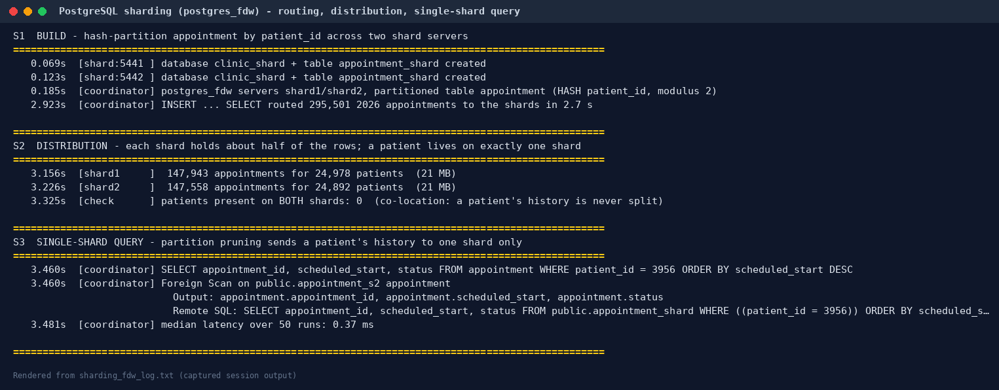
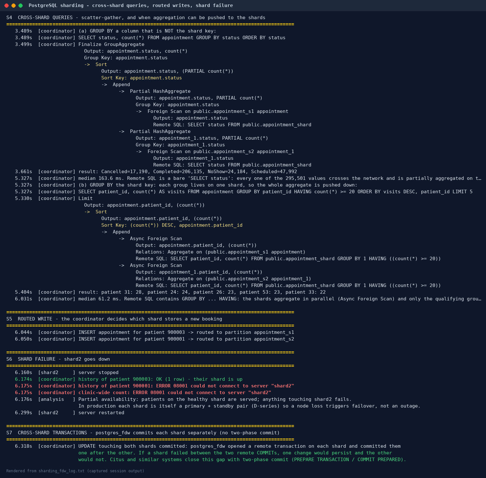
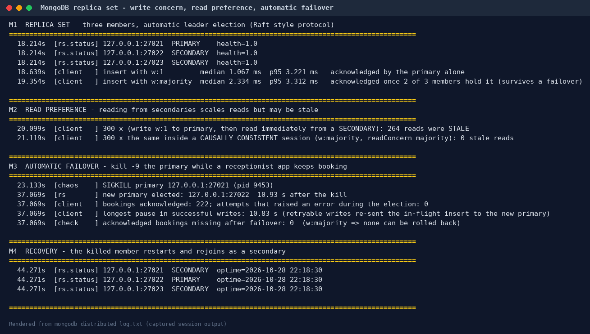
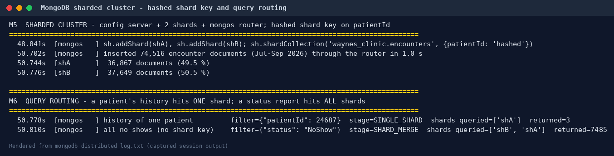

# Portfolio 5 — Distributed and Cloud Database Exercise

**Organisation:** Wayne's Clinic Baltimore · **Engines:** PostgreSQL 16 (6 servers) · MongoDB 8 (replica set + sharded cluster) · AWS reference design (Terraform)

A single database server is a single point of failure, and a hospital cannot stop booking patients because one machine died. This portfolio distributes the clinic database and measures what that buys and what it costs. It covers replication, consistency, availability, failover, sharding and a cloud deployment design. Everything in §1–§3 was **executed**. Thirteen database server processes ran on one host (six PostgreSQL, seven MongoDB), each with its own data directory, logs and port, standing in for separate machines. The AWS design in §4 is reference infrastructure-as-code, not deployed.

| Requirement | Where |
|---|---|
| Replication | §1 · D1–D2 · [`scripts/02_replication_failover_demo.py`](scripts/02_replication_failover_demo.py) |
| Consistency | §1 D2, D4 · §3 M2 |
| Availability and failover | §1 D5–D7 · §3 M3–M4 |
| Sharding | §2 (PostgreSQL + `postgres_fdw`) · §3 M5–M6 (MongoDB) |
| Deployment evidence | [`scripts/01_setup_pg_nodes.sh`](scripts/01_setup_pg_nodes.sh), [`cloud/docker-compose.yml`](cloud/docker-compose.yml), [`cloud/terraform/`](cloud/terraform/) · logs in [`evidence/`](evidence/) |

```
REPLICATION GROUP (PostgreSQL)                 SHARDED GROUP (PostgreSQL)              MONGODB
primary        :5433  read/write               coordinator :5440 postgres_fdw router   rsP5 replica set :27021-27023
 ├─ replica_sync  :5434  synchronous standby   ├─ shard1  :5441  hash(patient_id) = 0   config server    :27030
 └─ replica_async :5435  async, 3 s apply delay└─ shard2  :5442  hash(patient_id) = 1   shards shA/shB   :27031/:27032
                         (simulates a far DR site)                                       mongos router    :27040
```

---

## 1. Replication, consistency and failover (PostgreSQL)

`01_setup_pg_nodes.sh` initialises the primary with data checksums. It clones two standbys with `pg_basebackup -R` using physical replication slots, makes `replica_sync` synchronous (`synchronous_standby_names = 'FIRST 1 (replica_sync)'`) and gives `replica_async` a 3-second apply delay. It then loads the Portfolio 1 clinic schema and data on the primary, and both standbys receive it through WAL streaming.



**D1 Topology.** `pg_stat_replication` on the primary shows `replica_sync` streaming with `sync_state = sync` and `replica_async` with `async`. Both standbys report `pg_is_in_recovery() = true`.

**D2 Consistency.** A new patient is inserted on the primary with `synchronous_commit = remote_apply`:

| Node | Read immediately after `COMMIT` | Consistency |
|---|---|---|
| replica_sync | row found | **strong (read-your-writes)**: the commit waited until this standby had applied it |
| replica_async | row **not** found | **stale read**; the row appeared **3.04 s** later, which is **eventual consistency** |

**D3 Read-only standbys.** An `INSERT` on a standby fails with `25006 cannot execute INSERT in a read-only transaction`, while `SELECT` is served. Replicas scale reads (history screens, reports), not writes.

**D4 The price of consistency** — median commit latency of 300 single-row inserts for each `synchronous_commit` level:

| Level | What `COMMIT` waits for | Median | p95 |
|---|---|---:|---:|
| `off` | nothing (WAL flushed later; a crash can lose the last few hundred ms) | 0.093 ms | 0.152 ms |
| `local` | WAL flushed on the primary only | 0.413 ms | 0.656 ms |
| `remote_write` | standby received the WAL | 0.528 ms | 0.783 ms |
| `on` | standby flushed the WAL to disk | 0.627 ms | 0.845 ms |
| `remote_apply` | standby applied it (visible to its readers) | 0.743 ms | 0.951 ms |

Each step up in durability or consistency costs latency. Here the "network" is the loopback interface. Between Availability Zones a round trip is typically around a millisecond, and between distant regions tens of milliseconds, which is why the clinic should replicate **synchronously within a region and asynchronously across regions** (PACELC: *else, latency vs consistency*).



**D5 Availability vs consistency (CAP).** The synchronous standby is stopped. The next `COMMIT` on the primary **blocks** (`wait_event = IPC/SyncRep`): PostgreSQL refuses to confirm a write that only one server holds, choosing **consistency over availability** for writes. The operator switches to quorum commit (`synchronous_standby_names = 'ANY 1 (replica_sync, replica_async)'`) and reloads. The waiting commit completes at its next standby status report, **4.01 s** after it was issued. Both standbys are then shown as `sync_state = quorum`. Quorum commit is the recommended production setting: any one of two standbys can confirm, so losing one standby no longer stops writes.

**D6 Failover.** The primary is killed with `pg_ctl stop -m immediate`, simulating a power cut. `SELECT pg_promote()` on `replica_sync` makes it the new primary, accepting writes **0.12 s** after the crash on the new **timeline 2**. Every committed row was there: **rows lost = 0 (RPO = 0)**, because every commit had been confirmed by this standby. The surviving `replica_async` was re-pointed at the new primary with `ALTER SYSTEM SET primary_conninfo` and a reload, then resumed streaming without a rebuild.

**D7 Rejoin.** `pg_rewind` resynchronised the crashed old primary with the new one from the point where the timelines diverged, and it then started as a **standby of the new primary** in **0.8 s**. All three nodes converged on the same row count. Honest caveat: it copied 79 MB of the 96 MB data directory, mostly WAL segments, so on a database this small it saves little over a fresh `pg_basebackup`. The benefit grows with size, because relation files unchanged since the divergence are not copied.

> **Interpreting the 0.12 s failover.** Promotion itself is fast. In production the time is dominated by *detecting* the failure safely, without promoting during a short network blip and causing split-brain. Tools such as Patroni (with a consensus store) or a managed service add that detection. AWS states that Multi-AZ DB instance failovers typically complete within one to two minutes, and that Multi-AZ DB clusters with two readable standbys typically fail over in under 35 seconds ([AWS RDS Multi-AZ](https://aws.amazon.com/rds/features/multi-az)).

## 2. Sharding (PostgreSQL + postgres_fdw)

Replication copies *all* data to every node, which scales reads but not data volume or writes. **Sharding** splits rows across servers. On the coordinator, `appointment` is a `PARTITION BY HASH (patient_id)` table whose two partitions are **foreign tables living on two other servers** ([`scripts/03_fdw_sharding_demo.py`](scripts/03_fdw_sharding_demo.py)). This is native PostgreSQL, and it is the same idea that Citus automates.



| Step | Result |
|---|---|
| **S1 Routing** | 295,501 appointments from 2026 were inserted through the coordinator and routed by hash to the right shard (2.7 s, `batch_size 1000`) |
| **S2 Distribution** | shard1 147,943 rows / 24,978 patients; shard2 147,558 rows / 24,892 patients (50.0 / 50.0). **0 patients on both shards**: hashing on `patient_id` co-locates each patient's whole history |
| **S3 Single-shard query** | a patient's history becomes **one** `Foreign Scan on appointment_s2` (partition pruning); the remote SQL includes the `WHERE` and the `ORDER BY`. Median 0.37 ms |
| **S4a Query not on the shard key** | `GROUP BY status`: the remote SQL is a bare `SELECT status`, so all 295,501 values cross the network and are partially aggregated on the coordinator (163.6 ms). PostgreSQL 16's `postgres_fdw` cannot push a *partial* aggregate to a shard |
| **S4b Query on the shard key** | `GROUP BY patient_id HAVING count(*) >= 20`: each group lives on one shard, so the **whole aggregate is pushed down** and both shards work **in parallel** (`Async Foreign Scan`). 61.2 ms |
| **S5 Routed write** | a new booking for patient 900003 lands on shard1 and one for 900001 on shard2 |
| **S6 Shard failure** | shard2 stopped: patient 900003's history is **still served**; patient 900001 and any clinic-wide query fail with `08001 could not connect`. That is **partial availability** |
| **S7 Cross-shard writes** | an `UPDATE` touching both shards commits each shard separately. `postgres_fdw` has no two-phase commit, so a crash between the two commits could leave one shard changed |



**Design lessons.**

1. Choose the shard key to match the heaviest, most latency-sensitive query. Patient history is single-shard because the key is `patient_id`.
2. Queries that cut across the key, such as clinic-wide reports, become scatter-gather; send them to the columnar store from Portfolio 4 instead.
3. Each shard must itself be replicated (§1), or a node failure becomes a partial outage.
4. Cross-shard transactions need two-phase commit, which Citus and similar systems provide.

At Wayne's Clinic's real size (Portfolio 2: 2.6M rows, under 1 GB) **sharding is not yet needed**; one replicated PostgreSQL server is sufficient. The exercise shows how the design would scale when the clinic grows into a regional hospital network.

## 3. MongoDB: built-in replication, automatic failover and hashed sharding

[`scripts/04_mongodb_distributed_demo.py`](scripts/04_mongodb_distributed_demo.py) runs the Portfolio 4 document model on a three-member replica set and a two-shard cluster.



| Step | Result |
|---|---|
| **M1 Write concern** | `w:1` median 1.07 ms vs `w:majority` 2.33 ms. Majority waits until 2 of 3 members hold the write, which is what guarantees it survives a failover |
| **M2 Read preference** | write with `w:1`, then read **immediately from a secondary**: **264 of 300 reads were stale**. Inside a **causally consistent session** (`w:majority` + `readConcern: majority`): **0 of 300** stale. Read-your-writes on replicas has to be requested; it is not the default |
| **M3 Automatic failover** | `kill -9` on the primary while a client inserted a booking every 20 ms. The remaining members **elected a new primary in 10.9 s** (dominated by the 10 s default election timeout). Writes paused for 10.8 s, then continued: **222 bookings acknowledged, 0 errors** (retryable writes re-sent the in-flight insert), **0 acknowledged bookings lost** |
| **M4 Recovery** | the killed member restarted and rejoined as a secondary at the same optime |
| **M5 Hashed sharding** | `sh.shardCollection('waynes_clinic.encounters', {patientId: 'hashed'})`; 74,516 encounters inserted through `mongos` split **36,867 / 37,649 (49.5 / 50.5 %)** |
| **M6 Query routing** | `find({patientId: …})` → `SINGLE_SHARD`, one shard queried; `find({status: 'NoShow'})` → `SHARD_MERGE`, both shards queried |



**PostgreSQL vs MongoDB failover.** PostgreSQL needed an operator, or an external tool, to decide to promote, but did so instantly (0.12 s) and with RPO = 0 because replication was synchronous. MongoDB elected a leader automatically with no human in the loop, at the cost of about 11 s of write unavailability, also with RPO = 0 under `w:majority`. Both behaviours are **CP** in CAP terms: during the partition they paused writes rather than accept writes that could later be lost.

## 4. Cloud deployment design (AWS, reference)

Wayne's Clinic is a US healthcare provider, so patient data is Protected Health Information under HIPAA. Any cloud provider must sign a Business Associate Agreement, and only HIPAA-eligible services may hold PHI. AWS lists Amazon RDS (PostgreSQL), ElastiCache, DocumentDB, Keyspaces (Cassandra), Neptune, KMS, S3 and AWS Backup as HIPAA-eligible ([AWS HIPAA eligible services](https://aws.amazon.com/compliance/services-in-scope/HIPAA_BAA/)).

[`cloud/terraform/`](cloud/terraform/) encodes the design. It was **not applied**: no AWS account was used, and `terraform validate` could not download the AWS provider in the build environment. The files do parse and are canonically formatted (`terraform fmt`, Terraform 1.17.1).

| Concern | Design | Maps to evidence |
|---|---|---|
| Region | `us-east-1` (N. Virginia), the closest AWS region to Baltimore; DR in `us-east-2` (Ohio) | D4 latency |
| System of record | **RDS for PostgreSQL 16, Multi-AZ DB instance**: a synchronous standby in a second AZ with automatic failover. AWS SLA threshold 99.95% monthly uptime for Multi-AZ vs 99.5% single-instance ([RDS SLA](https://aws.amazon.com/rds/sla/)) | D2, D5, D6 |
| Read scaling | in-region read replica for history screens and management reports | D3 |
| Disaster recovery | **cross-Region read replica** (asynchronous; RPO = seconds of lag; promoted manually). The faster-failover Multi-AZ *DB cluster* option was rejected because AWS does not support cross-Region read replicas from a Multi-AZ DB cluster ([CreateDBInstanceReadReplica](https://docs.amazonaws.cn/en_us/AmazonRDS/latest/APIReference/API_CreateDBInstanceReadReplica.html)) | D2 (async lag), D6–D7 |
| Backups | automated backups, 35-day point-in-time recovery, deletion protection, final snapshot | C9 (WAL recovery) |
| Encryption | customer-managed KMS keys at rest (DB, snapshots, Performance Insights, ElastiCache); `rds.force_ssl = 1` and ElastiCache TLS in transit | — |
| Access | private subnets only; security group allows PostgreSQL only from the app tier; IAM database authentication; master password managed in Secrets Manager | P1 RBAC roles |
| Audit | `pgaudit` (read, write, DDL, role) + PostgreSQL logs to CloudWatch, i.e. HIPAA audit controls | — |
| Cache / queues | ElastiCache (Redis OSS) replication group, Multi-AZ automatic failover, TLS, AUTH token | Portfolio 4 Redis |
| Local reproduction | [`cloud/docker-compose.yml`](cloud/docker-compose.yml): primary + sync + async replicas from the official `postgres:16` image (not executed here: no container registry access; `01_setup_pg_nodes.sh` builds the same topology natively and *was* executed) | §1 |

**Recovery objectives proposed for the clinic.**

| Failure | Mechanism | RPO | RTO |
|---|---|---|---|
| One database host or AZ fails | Multi-AZ synchronous standby, automatic failover | 0 | about 1–2 min (AWS figure for Multi-AZ instances) |
| Whole region lost | promote the cross-Region replica, repoint the application | seconds (replica lag) | under 1 hour, operator-driven |
| Human error (bad `DELETE`) | point-in-time restore from the 35-day backup window | minutes | 1–2 h for a restore to a new instance |
| Redis node fails | ElastiCache failover; holds/caches rebuilt from PostgreSQL | caches only | seconds |

## 5. Consistency and availability: summary

| Mechanism (measured here) | Consistency | Availability during failure | Cost |
|---|---|---|---|
| PostgreSQL sync replica (`FIRST 1`) | strong, read-your-writes with `remote_apply` | writes **block** if the sync standby is lost (D5) | +0.2–0.3 ms per commit locally (D4) |
| PostgreSQL quorum (`ANY 1 of 2`) | strong | survives one standby failure | same |
| PostgreSQL async replica | eventual (3.04 s stale window) | always writable | none on commit; possible data loss on failover |
| postgres_fdw shards | per-shard strong; **no** cross-shard atomicity | partial: one shard down = its patients down (S6) | scatter-gather for non-key queries |
| MongoDB `w:majority` + causal session | read-your-writes, even on secondaries | automatic election, about 11 s write pause | +1.3 ms per write |
| MongoDB default reads from secondaries | eventual (264/300 stale) | high | — |

For a hospital, losing a committed diagnosis or prescription is unacceptable, while a short write pause is tolerable. The recommended configuration is therefore strong consistency for clinical writes (synchronous or quorum replication, `w:majority`), eventual consistency only for read-only reporting replicas and caches, and a tested failover runbook. These demos are, in effect, that runbook's first rehearsal.

## 6. Reproduce

```bash
sudo ./run_portfolio5.sh     # test machine only: it starts, kills and restarts database servers
# needs: PostgreSQL 16 binaries, the main clinic database from Portfolios 1-2 on :5432,
#        MongoDB 7/8 binaries (MONGO_BIN=/path/to/bin), Python psycopg + pymongo
```

### Sources

- [Amazon RDS Multi-AZ](https://aws.amazon.com/rds/features/multi-az) — failover times and standby behaviour
- [Amazon RDS Service Level Agreement](https://aws.amazon.com/rds/sla/) — 99.95% Multi-AZ vs 99.5% single-instance thresholds
- [AWS HIPAA Eligible Services](https://aws.amazon.com/compliance/services-in-scope/HIPAA_BAA/) — services covered by the AWS BAA
- [CreateDBInstanceReadReplica API reference](https://docs.amazonaws.cn/en_us/AmazonRDS/latest/APIReference/API_CreateDBInstanceReadReplica.html) — cross-Region replicas not supported from Multi-AZ DB clusters
- PostgreSQL 16 documentation: High Availability, Load Balancing and Replication; `pg_rewind`; `postgres_fdw`
- MongoDB 8.0 manual: Replication, Write Concern, Causal Consistency, Sharding
